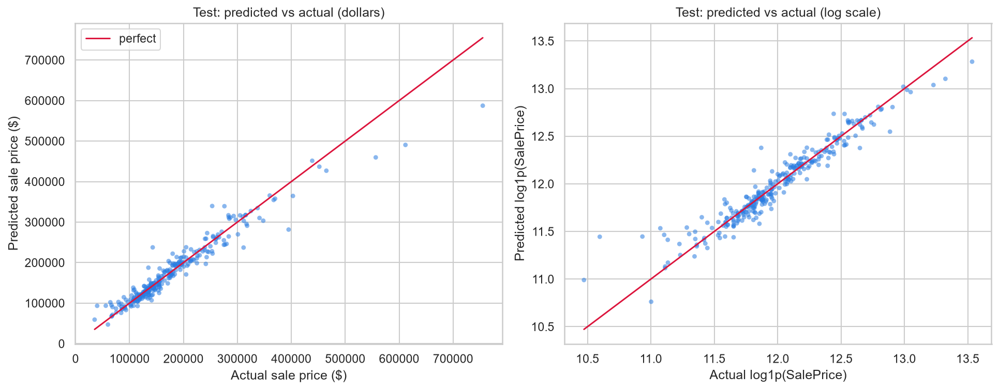
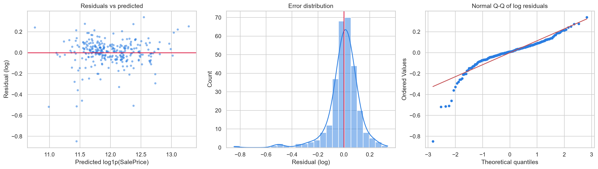
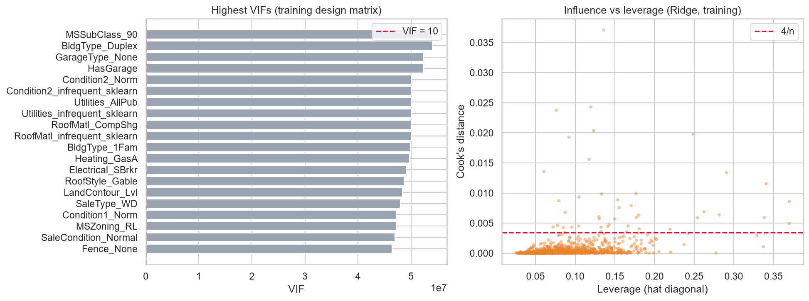
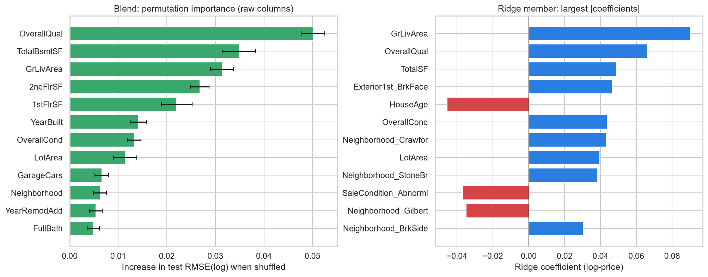
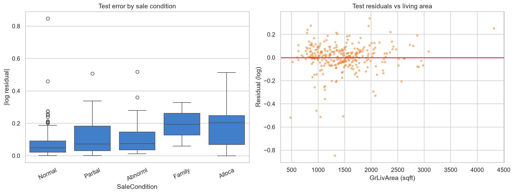

# House Price Prediction

End-to-end regression project on the Ames Housing dataset. It estimates a house's sale price
from its recorded characteristics using a leakage-safe scikit-learn pipeline, nested
cross-validation, a single held-out evaluation, and a reusable prediction CLI.

> **Status:** Phases 0-7 complete, including model packaging, prediction API, CI, and Docker.
> Requires Python 3.12 or newer; exact dependency versions are pinned in `requirements.txt`.

## Quick start

```bash
make setup                       # create .venv and install pinned dependencies/package
# put Kaggle's train.csv in data/raw/ (see data/README.md)
make data                        # create the fixed train/test split
make test                        # run tests
make train                       # tune, compare, fit, and save models/best_model.joblib
make evaluate                    # score the held-out test split; run this only once
make predict ARGS="--input-csv houses.csv --output predictions.csv"
make api                         # start the FastAPI service on http://localhost:8000
```

For a single complete Ames feature record, save one JSON object to a file and run:

```bash
.venv/Scripts/python -m house_price.predict --record-file house.json  # Windows
# .venv/bin/python -m house_price.predict --record-file house.json    # macOS/Linux
```

The JSON object must include the same raw feature columns used for training. A CSV can
contain an optional `Id` column; the output is a Kaggle-style `Id,SalePrice` file. Input
must not include `SalePrice`. To score one inline JSON object instead, use `--record-json`.

The command-line equivalents work from an activated environment as well:

```bash
python -m house_price.train
python -m house_price.evaluate
python -m house_price.predict --input-csv houses.csv --output predictions.csv
```

## Live prediction API

The optional FastAPI service loads the saved model once at startup and exposes:

- `GET /health` — readiness check.
- `POST /predict` — one JSON record containing every raw feature used by the trained pipeline.
  Returns `{"predicted_sale_price": ...}`. Missing required features or an included
  `SalePrice` target return HTTP 422.

Start locally with `make api` (or
`python -m uvicorn house_price.api:app --host 0.0.0.0 --port 8000`). Interactive API docs
are available at `http://localhost:8000/docs`.

## Experiment tracking

Each full saved training run appends one row per candidate model to
`reports/experiment_runs.csv`. Rows include the UTC run ID, candidate settings, CV metrics,
and which model was selected. This lightweight CSV tracker requires no tracking server.
Quick or partial training runs do not append tracking results.

## CI and Docker

GitHub Actions runs Ruff, Black's formatting check, and pytest on every push and pull request
using Python 3.12. To build the optional API container, first run `make train` to create the
local `models/best_model.joblib` artifact, then run `make docker-build` and
`docker run --rm -p 8000:8000 house-price-api`. The model artifact is excluded from Git, so
each deployment environment must provide its own trained artifact when building the image.

## Project layout

```
data/raw, data/processed   input data (git-ignored)
notebooks/                 exploration only
src/house_price/           reusable code, train/evaluate/predict CLIs, FastAPI app
models/                    saved model artifacts
reports/figures/           evaluation and diagnostic plots
reports/experiment_runs.csv appended candidate metrics from full training runs
tests/                     pytest
docs/decisions.md          problem, metric, evaluation protocol
.github/workflows/         push / pull-request CI
Dockerfile                 non-root FastAPI container; requires trained model artifact
```

## Approach

The target is modelled as `log1p(SalePrice)` and predictions are returned in dollars. Feature
engineering, imputation, encoding, and scaling are fitted inside scikit-learn pipelines.
Nested cross-validation on training rows selects the final model; the held-out 20% test split
is used only once, at the end. The saved artifact contains the complete fitted preprocessing
and model pipeline, so prediction applies the exact same transformations as training.

Run `make lint` for Ruff checks, `make format` to format Python code with Black, and
`make test` for pytest. `make train` performs the full nested-CV workflow; `--quick` is for
development only and does not save a final artifact.

## Roadmap

- [x] Phase 0: Setup and decisions
- [x] Phase 1: Data and EDA
- [x] Phase 2: Baseline
- [x] Phase 3: Features and preprocessing pipeline
- [x] Phase 4: Modelling and validation
- [x] Phase 5: Evaluation and diagnostics
- [x] Phase 6: Packaging (CLI, tests, docs)
- [x] Phase 7: Optional extras (API, experiment CSV, CI, Docker)

## Results

Nested 5-fold cross-validation on the training split (RMSE on log price, lower is better).
Settings are tuned inside each training fold, so these scores are not flattered by the tuning.
The test split was left untouched until Phase 5.

<!-- RESULTS:START -->
| Model | Tuned settings | CV RMSE (log) | Std | CV MAE ($) | CV R2 |
|---|---|---|---|---|---|
| Ridge (alpha=10, untuned) | alpha=10 (fixed) | 0.1100 | 0.0059 | 13,676 | 0.928 |
| LinearRegression | no hyperparameters | 0.1190 | 0.0063 | 14,306 | 0.920 |
| Ridge | alpha=31.6 | 0.1099 | 0.0058 | 13,806 | 0.926 |
| Lasso | alpha=0.000681 | 0.1102 | 0.0057 | 13,943 | 0.926 |
| ElasticNet | alpha=0.00681, l1_ratio=0.05 | 0.1100 | 0.0056 | 13,914 | 0.926 |
| RandomForest | min_samples_leaf=1, max_features=0.33, max_depth=None | 0.1276 | 0.0075 | 15,766 | 0.891 |
| GradientBoosting | subsample=0.6, n_estimators=800, min_samples_leaf=1, max_depth=4, learning_rate=0.05 | 0.1138 | 0.0056 | 14,050 | 0.916 |
| **Blend: Ridge + GradientBoosting** (selected) | equal-weight average of Ridge and GradientBoosting | 0.1067 | 0.0059 | 13,067 | 0.929 |
<!-- RESULTS:END -->

Earlier phases for reference: dummy 0.3906, numeric-only linear baseline 0.1258
(`docs/baseline_results.md`), Phase 3 pipeline with Ridge 0.1100 (`docs/preprocessing_results.md`).
Full tables, per-fold scores and tuning curves: `docs/model_results.md`, `reports/`.

## Held-out test (Phase 5)

Scored **once** on the 20% test split after model selection was finished. Outliers were
not dropped from the test rows (EDA decision 12). Diagnostics, coefficients and the
houses the model gets most wrong: `docs/evaluation_results.md`, `reports/figures/13_*.png`–`17_*.png`.

<!-- TEST_RESULTS:START -->
Held-out test scored **once** with the Phase 4 winner (**Blend: Ridge + GradientBoosting**).

| Split | n | RMSE (log) | MAE ($) | R2 |
|---|---|---|---|---|
| cv_train_5fold | 1166 | 0.1067 | 13,067 | 0.929 |
| test | 292 | 0.1236 | 13,798 | 0.930 |
| train_resubstitution | 1166 | 0.0547 | 7,077 | 0.981 |

Test RMSE(log) = **0.1236** (+15.9% vs CV). `train_resubstitution` refits nothing: it is the same frozen model scored on the rows it was trained on, so it is optimistic (especially for the tree member).

Top raw features by permutation importance (test): OverallQual (0.0502), TotalBsmtSF (0.0349), GrLivArea (0.0314), 2ndFlrSF (0.0268), 1stFlrSF (0.0221), YearBuilt (0.0142), OverallCond (0.0133), LotArea (0.0114).
<!-- TEST_RESULTS:END -->

## Evaluation figures

The held-out diagnostics and top test-set feature drivers are shown below. Full explanations,
assumption checks, coefficients, and worst-case errors are in
[`docs/evaluation_results.md`](docs/evaluation_results.md).










